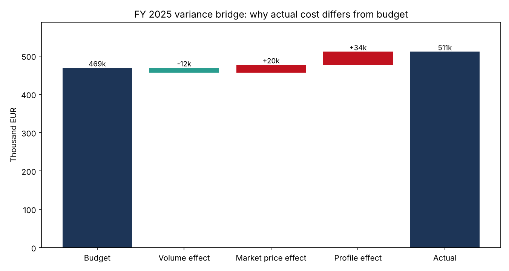
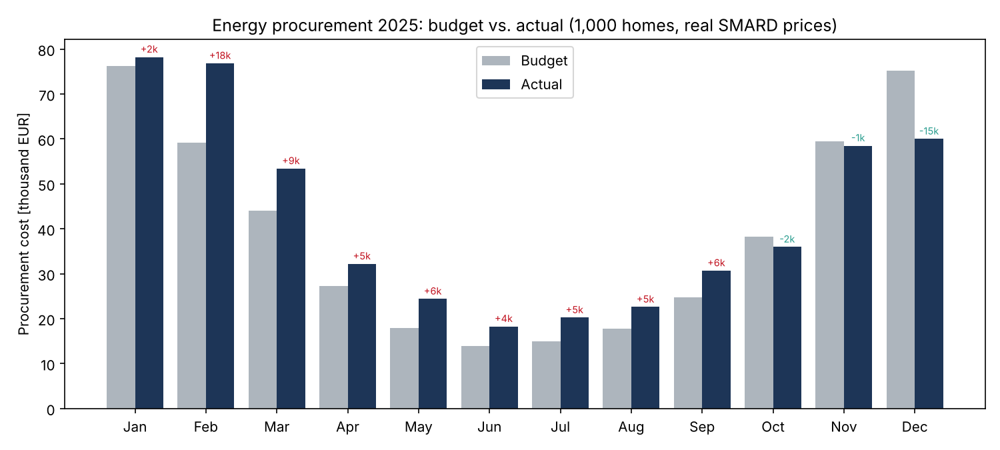
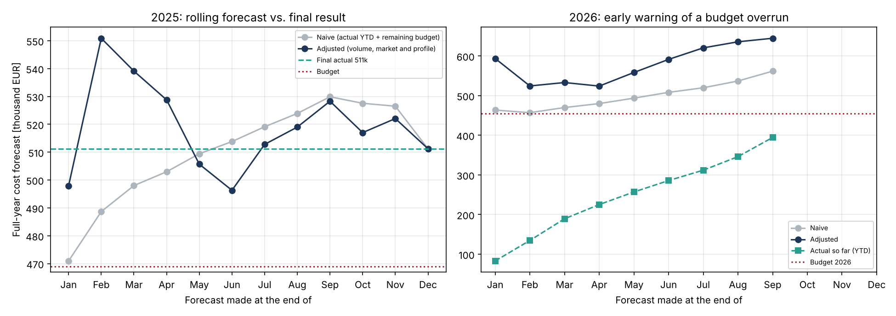
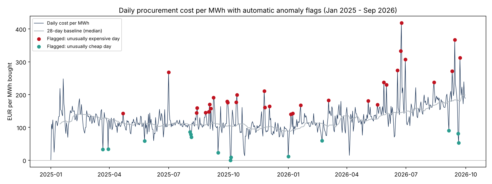

# Energy Cost Controlling – Budget vs. Actual, Variance Analysis & Forecasting on Real SMARD Prices

   📊 Live dashboard: [Open in Data Studio](https://datastudio.google.com/reporting/701014a8-dfae-433a-863c-762ed2fa73e9)

An electricity supplier (or a virtual power plant) buys power on the day-ahead market for **1,000 customer homes**.
Controlling has to answer three questions every month: *Are we on budget? Why not? Where will we end the year?*

This project builds that controlling workflow end to end on **real German day-ahead prices (SMARD, Jan 2025 – Sep 2026)**
and real Nürnberg weather: a **SQL data pipeline with automated data tests**, a **budget vs. actual variance analysis**
split into volume, market price and profile effects, a **rolling full-year forecast**, **daily anomaly detection**, and
CSV exports for a **Looker Studio dashboard**.

**Main findings:**
- **FY 2025:** procurement cost **511k EUR vs. 469k budget (+9.0%)**. The largest driver was not the market price but the **profile effect (+34k)**: homes with solar panels buy mostly in evening and winter hours, when power is most expensive. The budget's flat profile factor (1.10) underestimated this. In June, the actual factor was 1.73.
- **2026 (Jan–Sep):** cost is **37.5% over budget** (394k vs. 287k). Re-basing the budget on 2025's actual monthly profile factors removes the profile variance almost completely (+49k → −8k). What remains is the **market price effect (+66k)**: spot prices averaged 22% higher than in the same period of 2025.
- The **adjusted rolling forecast** flagged the 2026 overrun **at the end of January** (594k forecast vs. 454k budget), when the naive forecast still showed only +2%.
- The anomaly detector flagged **46 of 638 days (7%)**: 21 price spikes, 11 negative-price days and 14 unusually high or low price days.



## Pipeline

```
data/ (real SMARD prices, Open-Meteo weather)      seeds/budget_assumptions.csv (planning assumptions)
          │                                                        │
          ▼                                                        ▼
  src/portfolio.py  ── models hourly demand (actual weather + weather-normalised budget) ──►  SQLite: raw_hourly, seed_budget
          │
          ▼
  sql/01_staging.sql   stg_hourly, stg_budget_assumptions                   (clean, typed, local calendar)
  sql/02_facts.sql     fct_hourly_procurement                               (one row per hour: volumes, prices, costs)
  sql/03_marts.sql     mart_monthly_variance, mart_ytd, mart_daily_kpis     (reporting tables)
          │
          ▼
  tests/data_tests.sql   7 data quality tests: no duplicate or missing hours, prices within market limits,
                          variance components add up, monthly totals reconcile with hourly facts
          │
          ▼
  src/analytics.py     mart_rolling_forecast, mart_daily_anomalies
          │
          ▼
  results/*.png, results/*.csv, results/looker_studio/*.csv   (charts, tables and dashboard data)
```

The SQL is plain and portable: SQLite here so it runs with no installation, but the same models run on DuckDB,
BigQuery or Postgres, or as dbt/SQLMesh models, with minor changes.

## Data

| Source | What |
|---|---|
| [SMARD.de](https://www.smard.de) (Bundesnetzagentur) | Real hourly day-ahead prices, Germany/Luxembourg, Jan 2025 – Sep 2026 |
| [Open-Meteo](https://open-meteo.com) | Real hourly temperature and solar irradiance for Nürnberg |
| Modelled | Hourly demand of 1,000 homes: 3,500 kWh base load each, 600 heat pumps, 700 rooftop PV systems (8 kWp), 300 EVs |
| Assumptions (`seeds/`) | Budget base price per month (seasonal shape around an assumed annual average of 87 EUR/MWh for 2025 and 84 for 2026), budget profile factor 1.10, long-term monthly normal temperatures |

**Budget volume** is the same demand model run with temperatures shifted to long-term monthly normals, a
weather-normalised volume budget as utilities use it. **Actual volume** uses the real 2025–2026 temperatures.

## Variance analysis

For each month, the difference between actual and budget cost is split into three effects that **add up exactly**
(enforced by a data test):

```
Total variance  = V_a · P_a − V_b · P_b
Volume effect   = (V_a − V_b) · P_b                   more or less energy than planned, valued at the plan price
Market effect   = (S_a − B_b) · f_b · V_a             average spot price vs. the planned base price
Profile effect  = S_a · (f_a − f_b) · V_a             WHEN we buy: our demand shape vs. the average hour

V = volume, P = volume-weighted price, S_a = average spot price, B_b = budget base price,
f = profile factor = volume-weighted price / average price
```

| FY 2025 | EUR |
|---|---|
| Budget | 468,913 |
| Volume effect (warmer January and December, −2.8% volume) | −12,432 |
| Market price effect (spot level vs. plan) | +20,359 |
| **Profile effect** (buying in expensive hours) | **+34,381** |
| **Actual** | **511,221** |



**Why the profile effect is so large:** the portfolio's PV systems cover a lot of midday demand, so the remaining
grid purchases are concentrated in the morning, the evening and winter. In 2025, the actual profile factor ranged
from **1.02 in December to 1.73 in June**, against a flat 1.10 in the budget. Monthly, seasonal profile factors are
the obvious fix, and the 2026 re-basing shows that it works.

## Rolling forecast

At every month-end, the full-year cost is forecast in two ways:
- **Naive:** actual cost so far + budget for the remaining months.
- **Adjusted:** actual cost so far + remaining budget volume × year-to-date volume ratio × budget base price × recent market ratio (spot vs. plan over the last 3 months) × seasonal profile factor (last year's actual where available).



| | Mean abs. error vs. final FY 2025 |
|---|---|
| Naive, forecasts made Jan–Nov | 2.8% |
| Adjusted, forecasts made Jan–Nov | 2.9% |
| Naive, forecasts made May–Nov | 2.1% |
| Adjusted, forecasts made May–Nov | **1.8%** |

In 2025 the two methods were about equally good: prices stayed close to plan, and the adjusted method over-reacted
to the expensive February. **In 2026, the adjusted forecast was the useful one.** It showed a large overrun from
January onwards, while the naive forecast only caught up slowly as actual costs accumulated.

## Anomaly detection

Every day, the cost per MWh is compared with the **median of the previous 28 days** using a robust z-score (median
and MAD, so single outliers do not distort the baseline). Days with |z| > 3.5 are flagged and categorised. Only
past data is used, so it works as a daily alert in production.



| Category | Days |
|---|---|
| Price spike (hourly price above 300 EUR/MWh) | 21 |
| Negative prices (4+ hours) | 11 |
| High price level all day | 11 |
| Low price level all day | 3 |

The most extreme day was **24 June 2026**: 418 EUR per MWh bought vs. a baseline of 145, with an hourly price
of up to 666 EUR/MWh.

## Looker Studio dashboard

The files in `results/looker_studio/` are ready for [Looker Studio](https://lookerstudio.google.com) (free):

1. **Create → Data source → File Upload**, and upload `monthly_variance.csv`, `daily_kpis_with_anomalies.csv` and `rolling_forecast.csv` as three data sources.
2. **Create → Report**, and add:
   - **Scorecards:** sum of `cost_actual_eur`, `cost_budget_eur`, `variance_total_eur`
   - **Combo chart:** `year_month` × budget vs. actual cost
   - **Stacked bar:** `variance_volume_eur`, `variance_market_price_eur`, `variance_profile_eur` by `year_month`
   - **Time series:** `cost_per_mwh_eur` and `baseline_eur_mwh` by `date_local`
   - **Table:** daily anomalies (filter `is_anomaly = true`) with `category`
   - **Date range and year controls**
3. **Share → Anyone with the link can view**, and add the link to this README.

## How to run

```bash
pip install -r requirements.txt
python src/run.py
```

This runs in a few seconds and writes `build/controlling.db` (open it with any SQLite viewer to query the tables),
the charts and CSV files in `results/`, and the dashboard data in `results/looker_studio/`.

## Project structure

```
data/                 real SMARD prices and Open-Meteo weather
seeds/                budget assumptions (prices, profile factor, normal temperatures)
sql/                  staging, fact and mart models
tests/                data quality tests (queries that must return zero rows)
src/portfolio.py      data loading, time alignment, portfolio demand model
src/analytics.py      rolling forecast and anomaly detection
src/run.py            pipeline, exports and charts
results/              outputs; results/looker_studio/ = dashboard data
```

## Limitations

- **Demand is modelled, not metered:** no public dataset gives hourly demand for a real supplier portfolio. With real meter data, the pipeline stays the same.
- **Budget prices are assumptions,** not historical futures prices, which are not freely available.
- **Hedging is not modelled:** real suppliers buy most of their volume in advance on the futures market, which would dampen the market price effect. The analysis shows the exposure of an unhedged (fully spot-based) portfolio.
- **The day-ahead market has used 15-minute products since October 2025;** this project uses hourly values.

## Data licences

Electricity price data: Bundesnetzagentur | SMARD.de, CC BY 4.0. Weather data: Open-Meteo.com, CC BY 4.0.
